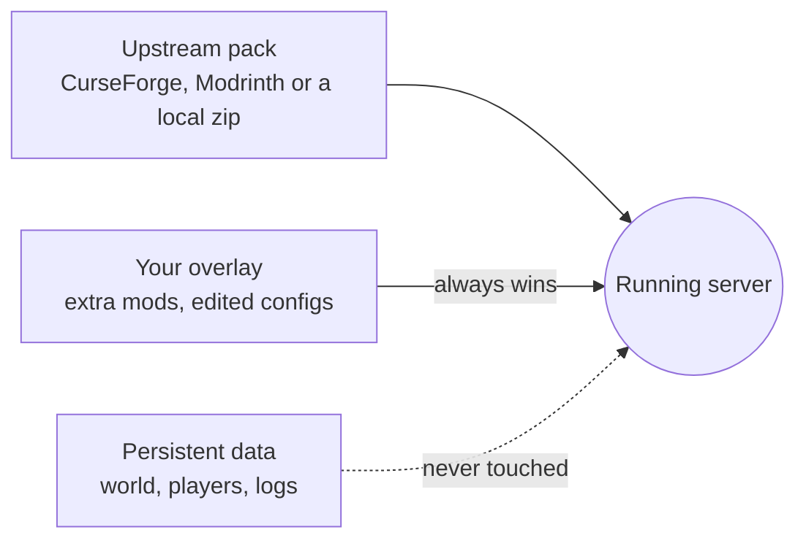
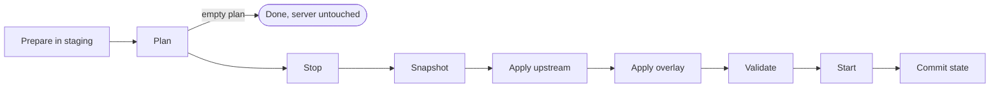

<div align="center">

# packctl

**Update self-hosted Minecraft modpack servers without losing your mods, configs or world.**

[](https://github.com/sennecools/packctl/actions/workflows/ci.yml)
[](https://github.com/sennecools/packctl/releases)
[](https://github.com/sennecools/packctl/releases)
[](LICENSE)
[](Cargo.toml)


[**Install**](#install) · [Quick start](#quick-start) · [Examples](#examples) · [Docs](docs/README.md) · [Report a bug](https://github.com/sennecools/packctl/issues/new/choose)

<!-- Rendered by .github/workflows/demo.yml from docs/demo.tape; uncomment once docs/media/demo.gif is committed.

-->

</div>

packctl is a single command-line tool that updates a modpack server the way you would by hand, only carefully: it
builds the new pack version in a staging folder, shows you exactly which files change, takes a snapshot, applies the
pack, puts your own mods and configs back on top, and starts the server again. One command undoes it.

> **Status:** pre-1.0 · Linux (x86_64, arm64) · CurseForge, Modrinth and local server packs.

## Why packctl

Updating a server pack usually means unzipping the new version over the old one and hoping. Mods you added get
deleted or duplicated, configs you tuned get reset, and when something breaks there is no way back. packctl treats a
server as three layers and only ever replaces the first one.



- **Upstream is replaced, not merged.** The pack's folders (`mods/`, `config/`, `kubejs/`, ...) end up exactly equal to the new version.
- **Your changes live in the overlay.** A mirror of the server root that is copied over the pack after every update.
- **Your world is not the pack's business.** `world/`, `logs/`, player lists and anything outside the pack's folders are left alone.

## Highlights

| | |
| --- | --- |
| **Plan first** | `packctl plan` shows what would be added, changed or removed (`-v` lists every file), and touches nothing. |
| **Snapshot + rollback** | Every change is snapshotted first, and `packctl rollback` restores the previous version. |
| **Overlay always wins** | Your mods and configs are re-applied after every update, with a notice when upstream changed a file you override. |
| **Adopt existing servers** | Point packctl at the version a hand-installed server runs; your additions and edits are found and kept. |
| **CurseForge (no key needed) + Modrinth + local zips** | CurseForge through a community proxy or your own key, Modrinth `.mrpack`s, or zips you drop in `packs/`. |
| **Works with your panel** | CubeCoders AMP out of the box, or any status/stop/start commands (systemd, screen, tmux, Docker). |
| **Path-safe by design** | Staging, traversal and symlink checks, hash-verified downloads, scoped removals and `.packctlignore`. |
| **Single static binary** | Statically linked musl builds for x86_64 and arm64, no runtime dependencies. |

## Supported providers

| Provider | `provider =` | Pack source | API key | Notes |
| --- | --- | --- | --- | --- |
| **CurseForge** | `"curseforge"` | the server pack paired with each version | not needed (community proxy); a personal key is recommended | downloads are SHA-1 and size verified |
| **Modrinth** | `"modrinth"` | the `.mrpack`; server files built from its index | never | the mod loader is reported, not installed |
| **Local** | `"local"` | `.zip` or `.mrpack` files dropped in `packs/` | never | works offline for `.zip` packs (a `.mrpack` still downloads its files); the newest file is the latest version |

## Controllers

| Controller | `type =` | How packctl stops and starts the server |
| --- | --- | --- |
| **CubeCoders AMP** | `"amp"` | `ampinstmgr` for the named instance, waiting until AMP reports it stopped or running |
| **Command** | `"command"` | your own `status`/`stop`/`start` commands, run without a shell; status exits 0 when running, 1 when stopped |

## Install

On the Linux machine that runs the server:

```bash
# Until v0.2.0 is released, install the rolling build (every commit on main that passed CI):
curl -fsSL https://raw.githubusercontent.com/sennecools/packctl/main/install.sh | sh -s rolling

# A specific release into a specific directory
curl -fsSL https://raw.githubusercontent.com/sennecools/packctl/main/install.sh | sh -s v0.2.0 "$HOME/bin"
```

The installer verifies the archive against the release's `SHA256SUMS` and installs to `~/.local/bin` (or
`/usr/local/bin` as root). From source, with Rust 1.88 or newer:

```bash
cargo install --git https://github.com/sennecools/packctl --locked
cargo binstall --git https://github.com/sennecools/packctl packctl
```

To verify a downloaded archive by hand, check it against `SHA256SUMS` and its build provenance attestation:

```bash
sha256sum -c --ignore-missing SHA256SUMS
gh attestation verify packctl-x86_64-unknown-linux-musl.tar.gz -R sennecools/packctl
```

Shell completions: `packctl completions bash > ~/.local/share/bash-completion/completions/packctl` (also zsh, fish,
powershell, elvish). More in [docs/installation.md](docs/installation.md), including
[downloading and verifying](docs/installation.md#verifying-a-download) by hand, upgrading and uninstalling.

## Quick start

```bash
cd /srv/minecraft/atm10                 # the server root
packctl create                          # wizard: modpack, controller; writes .packctl.toml here
packctl adopt --as "All the Mods 10-8.2" --apply   # only if the pack is already installed
packctl plan                            # preview the update; changes nothing
packctl update                          # stop, snapshot, apply, validate, start
packctl rollback                        # undo the last update
```

## Examples

After the create wizard, the outputs below come from the offline demo in [`scripts/demo/setup.sh`](scripts/demo/setup.sh):
a server running `demo-pack-1.0`, installed by hand, with a mod added and a config edited by the admin, updating to
`demo-pack-1.1`.

### Create a profile

```console
$ cd /srv/minecraft/atm10
$ packctl create atm10
Modpack (CurseForge or Modrinth URL, or a CurseForge project ID or slug): https://www.curseforge.com/minecraft/modpacks/all-the-mods-10
Server root: /srv/minecraft/atm10
Overlay directory (relative to the server root): /srv/minecraft/atm10/overlay
CurseForge API key (optional; leave empty to use the community proxy): [hidden]
Found 'All the Mods 10 - ATM10' (project 925200) yes
Server controller: amp
AMP instance name: ATM10

Created profile 'atm10'
  file:       /srv/minecraft/atm10/.packctl.toml
  pack:       All the Mods 10 - ATM10 (CurseForge project 925200)
  server:     /srv/minecraft/atm10
  overlay:    /srv/minecraft/atm10/overlay
  controller: amp (instance ATM10)
  api key:    not stored, using community proxy https://api.curse.tools (no API key configured)

Next: packctl status
```

When the server root already has mods in it, the wizard then asks which version it runs and offers to adopt it.

### Adopt a hand-installed server

A dry run against the demo server; [Adopting an existing server](#adopting-an-existing-server) explains the report.

```console
$ packctl adopt --as demo-pack-1.0
demo
Adopting as demo-pack-1.0 (id demo-pack-1.0.zip)
Scanned: config/, kubejs/, mods/

Matches the pack           8 files  → recorded
Edited by you              1 file   → overlay
  ~ config/sophisticatedbackpacks-common.toml
Added by you               3 files
  + config/spark/  → .packctlignore
  + mods/grieflogger.jar  → already in overlay
  + mods/spark-1.10.124-neoforge.jar  → overlay
Overlay conflicts          0

Dry run: nothing was changed.
Apply with: packctl adopt --as demo-pack-1.0.zip --apply
  This writes 2 files (0.0 MiB) to /tmp/packctl-demo/server/overlay, 1 rule to .packctlignore and .packctl/state.json.
```

### Plan an update

```console
$ packctl plan --to demo-pack-1.1
demo
demo-pack-1.0 → demo-pack-1.1

Upstream
  + 1 file
  ~ 1 file
  - 2 files

Server
  ✓ server checks passed
```

<details><summary><b>Show output</b> of <code>packctl plan -v --to demo-pack-1.1</code></summary>

```console
$ packctl plan -v --to demo-pack-1.1
demo
demo-pack-1.0 → demo-pack-1.1

Upstream
  + 1 file
  ~ 1 file
  - 2 files

Files
  + mods/create-1.21.1-6.0.4.jar
  ~ config/create-server.toml
  - mods/appleskin-neoforge-mc1.21-3.0.5.jar
  - mods/create-1.21.1-6.0.3.jar
  = config/sophisticatedbackpacks-common.toml (overlay, in sync)
  = mods/grieflogger.jar (overlay, in sync)
  = mods/spark-1.10.124-neoforge.jar (overlay, in sync)

Server
  ✓ server checks passed
```

</details>

### Update

```console
$ packctl update -n --to demo-pack-1.1
demo
demo-pack-1.0 → demo-pack-1.1

Upstream
  + 1 file
  ~ 1 file
  - 2 files

Update applied and committed.
  upstream: 2 files written
  overlay: 0 files copied
Rollback snapshot:
  /tmp/packctl-demo/server/.packctl/snapshots/2026-11-18T18-05-24Z-1
```

Without `-n` and `--to`, `update` lets you pick the version from a menu, and it asks `Apply update?` first. When
nothing changed it prints `No changes needed.` and never stops the server.

### Roll back

```console
$ packctl rollback
Rolled back to demo-pack-1.0 (id demo-pack-1.0.zip)
Snapshot: /tmp/packctl-demo/server/.packctl/snapshots/2026-11-18T18-05-24Z-1
```

### Status and versions

```console
$ packctl status
demo
  Installed: demo-pack-1.1 (id demo-pack-1.1.zip)
  Provider: local
  Adopted: demo-pack-1.0 on 2026-11-18T18:05:24Z
  Last update: 2026-11-18T18:05:24Z
  Managed files: 7
  Snapshots: 2
  Server: Running

$ packctl versions
Available versions for demo
  1. demo-pack-1.1 (id demo-pack-1.1.zip)
  2. demo-pack-1.0 (id demo-pack-1.0.zip)
```

`packctl doctor` and `packctl validate` check the profile, controller, provider and managed files; their output is in
[docs/commands.md](docs/commands.md#doctor).

## Adopting an existing server

*"This server runs All the Mods 8. I installed it by hand, added a few mods and tuned some configs, and I don't want to
start over."* Tell packctl which version it runs:

```bash
packctl adopt --as 1.1.0            # dry run: prints the report, writes nothing
packctl adopt --as 1.1.0 --apply    # record it (asks first; -y skips the question)
```

- **What is detected.** adopt prepares that version in staging and compares every file in the pack's folders with it
  by path, size and hash (jars also by mod id): files that match, configs you edited, mods and scripts you added, pack
  mods you swapped, disabled or removed, and runtime data such as databases and logs.
- **Where it goes.** Matching files are recorded as installed. Edited files and added mods are copied into the overlay;
  configs your added mods wrote, runtime data and your removals become `.packctlignore` rules. The pack folders
  themselves are never modified.
- **Dry run until `--apply`.** Without it, adopt only prints the report and the exact files and rules it would write.
  Local and Modrinth packs can guess the version with `--detect`; CurseForge packs need `--as`.
- **Undo with `packctl rollback`.** `--apply` takes a snapshot first, and right after it `packctl plan` shows only what
  the next version really changes.

Every class, flag and refusal, the `.packctlignore` block and a full run are in [docs/adopting.md](docs/adopting.md).

## CurseForge access

- **No key is needed by default.** Without a key, packctl reads CurseForge metadata through the community proxy
  [api.curse.tools](https://api.curse.tools). It is not affiliated with CurseForge, has no SLA, caches responses for up
  to an hour, and using it sits in a grey area of the CurseForge third-party API terms.
- **packctl never ships or borrows another application's API key.** Your own key goes to `api.curseforge.com` and,
  for downloads, to CurseForge's CDN (`*.forgecdn.net`), never to the community proxy. A custom endpoint gets it only
  when you set `PACKCTL_CF_PROXY_SEND_KEY=1`.
- **For production servers, use your own key.** Get a free one at [console.curseforge.com](https://console.curseforge.com/)
  and store it once for every server with `packctl apikey --global` (encrypted at rest).
- **Bring your own endpoint.** `PACKCTL_CF_API_BASE` (or `api_base` in the profile) points packctl at a self-hosted
  proxy such as [bmpm-mc/cfproxy](https://github.com/bmpm-mc/cfproxy) or
  [CurseForge.ApiProxy](https://github.com/CurseForgeCommunity/CurseForge.ApiProxy).
- **Downloads come from CurseForge's CDN** over https and are checked against the SHA-1 and size CurseForge reports.
  CurseForge has announced that its CDN will require a key; when it does, keyless downloads stop working and packctl
  tells you to configure one.

Details, including every error message and what to do about it, are in [docs/providers.md](docs/providers.md#curseforge).

## How it works



Preparation (resolve, download, verify, extract, scan the overlay) never touches the server, and `plan` shows the exact
plan `update` executes. Every top-level folder the new version ships converges on the pack plus your overlay. State is
committed last, so a failed update never records the new version, and the error names the snapshot to roll back to.
The planner rules, `state.json` and snapshots are in [docs/how-it-works.md](docs/how-it-works.md).

## Configuration

`packctl create` writes a `.packctl.toml` into the server root, with paths relative to it:

```toml
name = "atm10"

[server]
root = "."

[pack]
provider = "curseforge"
project_id = 925200
slug = "all-the-mods-10"

[overlay]
path = "overlay"

[controller]
type = "amp"
instance = "ATM10"
```

The overlay mirrors the server root, and `.packctlignore` protects runtime data inside the pack's folders:

```text
overlay/
├── mods/
│   └── grieflogger.jar
├── config/
│   └── sophisticatedbackpacks-common.toml
└── server.properties
```

```gitignore
# .packctlignore: paths the update never removes or replaces
config/luckperms/       # a permission plugin's database
defaultconfigs/ftbranks/
config/*.bak            # * matches within one path segment
```

Every field, global profiles, API key storage and environment variables are in
[docs/configuration.md](docs/configuration.md); overlay and ignore rules in [docs/overlay.md](docs/overlay.md).
Example profiles: [CurseForge](examples/atm10.toml), [Modrinth](examples/modrinth.toml), [local](examples/local.toml).

## Commands

| Command | What it does |
| --- | --- |
| `packctl list` | List profiles: global ones as a table, plus the local `.packctl.toml` here. |
| `packctl create [NAME]` | Create a profile, interactively or with flags (`-n`). |
| `packctl adopt [server] --as <VERSION>` | Record a hand-installed server (`--detect`, `--apply`). |
| `packctl status [server]` | Installed version, managed files, snapshots, server state (`--json`). |
| `packctl versions [server]` | List upstream versions with their ids (`--json`). |
| `packctl plan [server] [--to <VERSION>]` | Preview an update; changes nothing (`-v`, `--json`). |
| `packctl update [server] [--to <VERSION>]` | Apply an update (`-n` for no prompts, `--force-sync`). |
| `packctl rollback [server]` | Restore the latest snapshot. |
| `packctl doctor [server]` | Check the environment, controller and provider. |
| `packctl validate [server]` | Hash-check managed files plus the doctor checks. |
| `packctl apikey [server]` | Store, show or remove the CurseForge key (`--global`, `--stdin`, `--show`). |
| `packctl completions <SHELL>` | Print a shell completion script. |

`[server]` names a global profile; without it, packctl uses `.packctl.toml` in the current directory. Every flag is in
[docs/commands.md](docs/commands.md).

## Safety guarantees

- **Staging before mutation.** Downloads, extraction and planning happen outside the server root.
- **Snapshot before mutation.** The files a change touches are copied to `.packctl/snapshots/` first, with the previous state.
- **Commit last.** The new version is recorded only after files, overlay, validation and start all succeeded.
- **Scoped removals.** Only files inside the pack's folders (or files packctl installed from an earlier pack version) can be removed, never persistent data, overlay files or ignored paths.
- **Hostile packs are contained.** Archive, index and overlay paths with `..`, absolute parts or NUL bytes are rejected, and symlinks are not followed.
- **Force-sync guard.** An update that would delete or overwrite a file packctl never installed, or write an overlay file over a live file that changed outside packctl, is refused until you keep those files (overlay, `.packctlignore`, or `packctl adopt` for a server packctl has never recorded) or pass `--force-sync`. Live edits to files the pack installed are not protected: an update puts the pack's version back, so keep such edits in the overlay.

More, and how to recover from a failed update, in [docs/safety.md](docs/safety.md).

## FAQ

<details><summary><b>Do I need a CurseForge API key?</b></summary>

No. Without one, packctl reads metadata through the community proxy (see [CurseForge access](#curseforge-access)). A free
personal key is more dependable: `packctl apikey --global`. Modrinth and local packs never need a key.
</details>

<details><summary><b>Will it touch my world?</b></summary>

No. `world/`, `logs/`, `backups/`, `crash-reports/`, `ops.json`, the whitelist, ban lists and `usercache.json` never
enter a plan, even when a pack ships them, and neither does `server.properties` unless your overlay provides it.
Folders the pack does not ship are never swept; only files packctl installed there from an earlier pack version are
removed once the pack drops them.
</details>

<details><summary><b>What happens to mods I added by hand?</b></summary>

Keep them in `overlay/mods/` and they are re-applied after every update. A jar dropped straight into `mods/` is not part
of the pack, so it blocks the next update: `plan` lists it under files packctl never installed, and `update` refuses
until you move it to `overlay/mods/`, add a `.packctlignore` rule, or pass `--force-sync` to delete it. `packctl adopt`
moves existing additions for you.
</details>

<details><summary><b>How do I go back?</b></summary>

`packctl rollback` stops the server, restores the files and state of the last change, and starts it again. Run it again
to step back further.
</details>

<details><summary><b>Does it install Forge, NeoForge or Fabric?</b></summary>

No, only the pack's files. For Modrinth packs the plan shows the Minecraft and loader versions the pack needs and warns
when the installed loader does not match.
</details>

<details><summary><b>Pterodactyl, Docker or systemd?</b></summary>

Use the command controller with whatever starts and stops your server (`systemctl`, `docker compose`, `screen`, a panel
CLI), and run packctl where the server files live. Dedicated controllers are on the [roadmap](#roadmap).
</details>

<details><summary><b>Windows or macOS?</b></summary>

Release binaries are Linux only (x86_64 and arm64), because the controllers and server checks assume a Linux host. The
test suite runs on Windows and macOS in CI and `cargo install` builds there, but only Linux servers are supported. On
Windows, run packctl inside WSL next to the server files.
</details>

## Limitations

- **No config merging.** The pack's version of a file wins unless your overlay replaces the whole file.
- **No mod loader installation.** Install or update Forge, NeoForge, Fabric or Quilt yourself.
- **Linux only** for release binaries and the server-side features (the tests also run on Windows and macOS).
- **No CurseForge version detection.** `adopt --detect` works for local and Modrinth packs; for CurseForge pass `--as`.
- **Not a launcher or a panel.** packctl does not run, back up or monitor the server.

## Roadmap

- [x] Plan, update, rollback, snapshots, overlay and `.packctlignore`
- [x] CurseForge without a personal key, Modrinth `.mrpack`, local zips and `.mrpack`s
- [x] `packctl adopt` with `--detect` for local and Modrinth packs
- [x] AMP and command controllers, shell completions, `--json` output
- [ ] Mod loader installation (Fabric first)
- [ ] systemd, Pterodactyl and Docker controllers
- [ ] CurseForge version detection
- [ ] crates.io and AUR packages
- [ ] Man page

## Development

```bash
cargo build
cargo test
cargo clippy --all-targets --all-features -- -D warnings
cargo fmt --check
```

CI ([ci.yml](.github/workflows/ci.yml)) is the single quality gate: fmt and clippy, tests on Linux, Windows and macOS,
an MSRV check, `cargo-deny` and shellcheck. Releases and the rolling build publish only commits that passed it, as static
musl binaries with provenance attestations. Tests never touch the network: providers run against JSON fixtures and an
in-memory fetcher, and controllers against shell scripts.

```text
src/
├── cli/            # one module per command, argument parsing, output
├── config/         # profiles (.packctl.toml) and encrypted secrets
├── controllers/    # AMP and command controllers
├── core/           # planner, executor, updater, adopt, snapshots, state, ignore rules
├── fs/             # path safety, extraction, hashing, copying
└── providers/      # CurseForge, Modrinth, local archives, verified downloads
```

See [CONTRIBUTING.md](CONTRIBUTING.md) before opening a pull request, and [CHANGELOG.md](CHANGELOG.md) for what changed.

## License

[MIT](LICENSE) © 2026 Senne Cools.

packctl is an independent project and is not affiliated with CurseForge/Overwolf, Modrinth, Mojang or CubeCoders.
