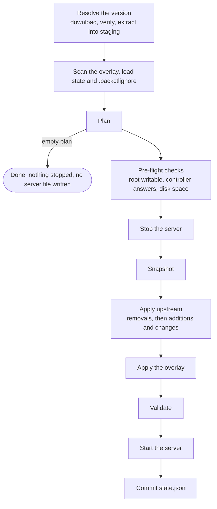

[← Docs](README.md)

# How it works

## Three layers

packctl sees a running server as three layers:

```text
UPSTREAM PACK  +  LOCAL OVERLAY  +  PERSISTENT DATA  =  RUNNING SERVER
```

- **Upstream pack.** What the pack author ships, managed as whole versions, never mod by mod. The selected version is
  authoritative for the folders it ships.
- **Local overlay.** Your files, copied over the pack after every update. The overlay always wins.
- **Persistent data.** The world, player lists, logs and anything outside the pack's folders. Never replaced because
  a pack version lacks it, never replaced because a pack version has it.

## The update flow



`packctl plan` runs everything up to and including the plan, then prints it. `packctl update` prints the same plan,
asks for confirmation and executes exactly that plan; it never plans again between the preview and the change. An
error after the stop leaves the new version uncommitted and names the snapshot to roll back to (see
[safety.md](safety.md#when-an-update-fails)).

## The planner

The planner compares four inputs: the recorded state, the staged version, the overlay and the live server. It is the
same code for `plan`, `update` and the first-update check.

1. **Removals.** Every file inside a folder the new version ships (its *pack-owned folders*, such as `mods/`,
   `config/`, `kubejs/`) that the new version does not contain is removed, unless it is persistent data, matched by
   `.packctlignore`, reserved (packctl's own files, the overlay, `packs/`) or provided by the overlay. This applies to
   every file in those folders, not only files packctl installed, so the server converges on the pack. A file
   packctl recorded installing from an earlier version is also removed when the new version no longer ships it,
   even when its folder is gone from the pack. Removals of files packctl never installed are listed separately, so
   they can be confirmed.
2. **Additions and changes.** Each file of the new version that is not persistent, ignored, reserved or provided by
   the overlay is compared with what packctl recorded and with the live file:
   - recorded with a different hash than the new version: replaced;
   - recorded with the same hash and the live file matches: nothing to do;
   - recorded but missing or changed on disk: restored from the pack;
   - not recorded (a hand-installed server): compared with the live file, so an identical file is left alone, a
     different one is replaced and a missing one is added. On a server packctl already manages, such a replace is
     listed separately too, because packctl never installed the file it overwrites.
3. **Persistent data and folders the pack does not ship** never enter the plan at all (apart from the recorded
   files above), even when the pack ships a persistent path such as `world/` or `server.properties`.
4. **Overlay.** Every overlay file wins. If the pack changed the file the overlay replaces since the last update,
   the plan raises the [conflict notice](overlay.md#the-conflict-notice); it does so on every update where it happens,
   because packctl remembers the pack's version of each overlay-owned path (`overlay_shadowed`). An overlay file that
   already matches the live file is in sync and does not make the plan non-empty.

The plan is sorted, so the same inputs always print the same plan. It also carries notices: the Minecraft and loader
versions a Modrinth pack needs, duplicate mod ids (the same mod twice in `mods/` from the pack, the overlay or kept
files), a newer version that targets another Minecraft version, and files a pack tried to write into reserved paths.

`update` refuses, unless you pass `--force-sync`, a plan that deletes or overwrites files packctl never installed,
writes an overlay file over a live file that changed outside packctl, or, when state is empty (a server packctl never
recorded), deletes or overwrites anything; [adopt](adopting.md) such a server first (see
[the force-sync guard](safety.md#the-force-sync-guard)). An empty plan that only changes the record (a new version id
with identical files) rewrites `state.json` without stopping the server.

## state.json

Each server keeps its state in `<server root>/.packctl/state.json`. It records what packctl knows, not server data:

| Field | Meaning |
| --- | --- |
| `installed_version`, `provider_version_id` | The installed pack version's name and id. |
| `provider`, `project` | Which provider and project the version came from. |
| `minecraft` | The Minecraft version the installed version targets, when known; "latest" stays on it. |
| `managed_files` | Every pack file packctl installed or recorded: relative path → SHA-256 and size. A file adopt accepted as only reformatted also carries `local_sha256`. |
| `overlay_shadowed` | The pack's fingerprint of each path the overlay replaces, for the conflict notice. |
| `overlay_applied` | The fingerprint of each overlay file as last written, to tell your overlay edits from drift on the server. |
| `last_successful_update` | When the last update committed. |
| `adopted` | Set by `packctl adopt`: when, which version, the overlay files it added and the ignore rules it wrote. |

`state.json` is written atomically and only in the last step of an update. The same folder holds `update.lock`, the
lock that keeps two updates or rollbacks from running at once.

## Snapshots

Before the first change, packctl copies every file the plan will touch, plus `state.json`, into a new snapshot:

```text
.packctl/snapshots/2026-11-18T18-16-14Z-1/
├── manifest.json
└── files/
    ├── .packctl/state.json
    ├── config/create-server.toml
    ├── config/sophisticatedbackpacks-common.toml
    ├── mods/appleskin-neoforge-mc1.21-3.0.5.jar
    ├── mods/create-1.21.1-6.0.3.jar
    ├── mods/grieflogger.jar
    └── mods/spark-1.10.124-neoforge.jar
```

The folder name is the UTC time, with a `-1`, `-2`, ... suffix when two snapshots fall in the same second.
`manifest.json` records the SHA-256 and size of each copied file, and `tracked_paths` lists every path the change was
going to touch, including files it was about to add. Rollback restores the copied files, deletes tracked paths that
did not exist before, and marks the snapshot as restored so it is never restored twice. Snapshots taken by
`packctl adopt` hold `state.json`, `.packctlignore` and the overlay paths adopt creates.

Snapshots are never deleted automatically. They contain only the files a change touched (never the world), so they
stay small; delete old ones from `.packctl/snapshots/` when you no longer need them.
